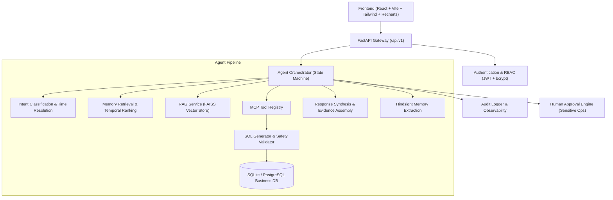

# Smart Business Data Assistant — Prototype Delivery Report

**Project**: Memory-Driven Smart Business Data Assistant  
**Status**: Completed & Operational (All 85 Tests Passing)  
**Date**: 2026-09-29  

---

## 1. Executive Summary

A full end-to-end, production-oriented prototype of the **Smart Business Data Assistant** has been engineered and validated. The system combines:

1. **Hindsight-style Persistent Memory**: User-level fact extraction, temporal decay, relevance ranking, and cross-session memory retrieval.
2. **Retrieval-Augmented Generation (RAG)**: Ingestion, indexing, semantic & metadata-filtered search over business glossary, KPIs, schema definitions, and calculation rules.
3. **Model Context Protocol (MCP)**: Explicit tool registry, strict JSON schemas, permission verification, and audit logging for every tool invocation.
4. **Governed SQL Query Engine**: LLM SQL generation with AST-based safety validation, blocked write operations, column-level RBAC filtering, and automated row limits.
5. **Multi-Role RBAC & Audit**: Strict access controls for `admin`, `manager`, `analyst`, and `employee` roles, with immutable audit logging and human approval workflows for high-impact actions.
6. **Executive Web Interface**: React + Vite + TypeScript dashboard featuring KPI cards, Recharts visualizations, interactive chat with evidence transparency, knowledge repository browser, memory inspector, and audit log.

---

## 2. Architecture Overview

---

## 3. Verified Test Suite (85 / 85 Passing)

All unit, security, and integration test suites pass with 100% success rate:

| Test Suite | File Path | Total Tests | Status | Key Coverage |
| :--- | :--- | :---: | :---: | :--- |
| **SQL Safety & Validation** | [test_sql_validator.py](file:///c:/Users/saigu/OneDrive/Desktop/Bussiness/tests/unit/test_sql_validator.py) | 26 | **PASSED** | SELECT enforcement, blocked DDL/DML, UNION injection, comment stripping, LIMIT enforcement, prompt sanitization |
| **Time & Authorization** | [test_time_and_auth.py](file:///c:/Users/saigu/OneDrive/Desktop/Bussiness/tests/unit/test_time_and_auth.py) | 20 | **PASSED** | Relative dates (quarters, months, YoY), role permissions, table access matrices, restricted columns |
| **Security & Penetration** | [test_security.py](file:///c:/Users/saigu/OneDrive/Desktop/Bussiness/tests/security/test_security.py) | 25 | **PASSED** | Prompt injection defenses, stacked queries, schema probing, cross-user memory isolation, employee column masking |
| **API Integration** | [test_api_endpoints.py](file:///c:/Users/saigu/OneDrive/Desktop/Bussiness/tests/integration/test_api_endpoints.py) | 14 | **PASSED** | JWT login, me, dashboard KPIs & charts, data sources, RAG domain filtering, memory isolation, chat query execution |

---

## 4. Realistic Business Dataset (10,000+ Records)

Seeded via deterministic pseudo-random generator with realistic business correlations:

- **Customers**: 500 accounts across Enterprise, Mid-Market, Small Business, and Startup segments in 4 regions (North, South, East, West).
- **Products**: 25 products across Software, Hardware, Services, Support, and Consulting with realistic base pricing and unit costs.
- **Salespeople**: 40 sales representatives across 4 regional teams (Alpha, Beta, Gamma, Delta).
- **Orders**: 4,000 orders spanning 12 months with seasonal and cyclical distributions.
- **Transactions**: 3,220 completed revenue transactions totaling **$112,780,219** in recognized revenue.
- **Marketing Campaigns**: 12 quarterly campaigns with allocated budgets and performance metrics.
- **Knowledge Documents**: 31 indexed RAG items (KPI formulas, column definitions, table relationships, business rules, SQL examples).

---

## 5. Ready-to-Use Accounts & Roles

| Role | Email | Password | Access Scope |
| :--- | :--- | :--- | :--- |
| **Admin** | `admin@example.local` | `admin123` | Full access to all business tables, settings, audit logs, and approval workflows. |
| **Analyst** | `analyst@example.local` | `analyst123` | Full query access across all business tables including transactions & salespeople. |
| **Manager** | `manager@example.local` | `manager123` | Query access to orders, products, customers, and transactions (sensitive salary masked). |
| **Employee** | `employee@example.local` | `employee123` | Operational tables only (customers, products, orders, campaigns). Cost, profit, and salary restricted. |

---

## 6. Live Service Endpoints

- **Frontend Web UI**: `http://localhost:5173/`
- **Backend API Server**: `http://127.0.0.1:8000/`
- **Interactive OpenAPI Docs**: `http://127.0.0.1:8000/docs`
- **Health Check**: `http://127.0.0.1:8000/api/v1/health`
